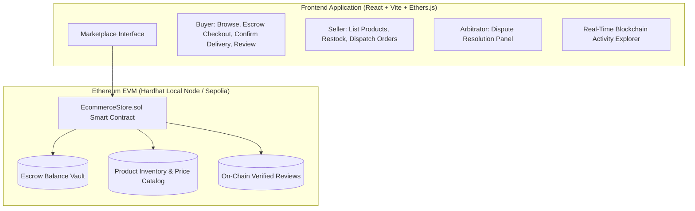

# Blockchain-Based Secure E-Commerce Transaction System (ChainStore)

> **Course**: Cryptocurrency and Blockchain  
> **Topic**: Smart Contract-Enforced Escrow Payments, Decentralized Product Registry & Tamper-Proof Verified Reviews  
> **Tech Stack**: Solidity `^0.8.24`, Hardhat, OpenZeppelin, React 18, Vite, Tailwind CSS, Ethers.js v6

---

## 🌟 Key Highlights & Academic Contributions

1. **Zero-Trust Smart Contract Escrow**:
   - In traditional e-commerce, buyers risk paying for undelivered goods, while sellers face chargeback fraud.
   - ChainStore locks purchase funds (ETH) into an immutable Solidity escrow contract. Funds are released to the seller **only when the buyer confirms physical delivery**, or automatically refunded if the seller defaults.
2. **Sybil-Resistant Verified Reviews**:
   - Fake reviews on platforms like Amazon and eBay cost billions in fraud.
   - In ChainStore, only an Ethereum address that owns a **completed on-chain order** can call `submitReview()`. Rating scores are cryptographically tied to order IDs, eliminating fake review manipulation.
3. **Decentralized Multi-Party Dispute Arbitration**:
   - If an item arrives damaged or counterfeit, either party can trigger `openDispute()`. A neutral platform arbitrator reviews evidence and renders an on-chain verdict (atomic refund or fund release).
4. **Dual Wallet Mode (MetaMask + Demo Persona Switcher)**:
   - Evaluators and professors can test using real **MetaMask**, or use the built-in **Quick Persona Switcher** to instantly toggle between Buyer (Alice), Tech Seller, and Platform Arbitrator without needing multiple browser profiles or wallet installations.

---

## 🏗️ System Architecture



---

## 🚀 Quickstart Guide

### Prerequisites
- **Node.js** (v18, v20, v22, or v23)
- **npm** (comes with Node.js)
- Optional: **MetaMask extension** in your browser

---

### Step 1: Install Dependencies

Open terminal in the project directory:

```bash
# Install smart contract & test dependencies
npm install

# Install frontend dependencies
npm --prefix frontend install
```

---

### Step 2: Run Unit Tests (18 Passing Tests)

Verify that the smart contracts satisfy all security, escrow, and access control invariants:

```bash
npx hardhat test
```

Expected output:
```text
  EcommerceStore Smart Contract
    1. Deployment & Initial State
      ✓ Should deploy with correct owner and initial metrics
    2. Product Catalog Management
      ✓ Should allow seller to list a new product
      ✓ Should reject listing product with empty name, zero price, or zero stock
      ✓ Should allow only seller to update stock
      ✓ Should allow seller or owner to toggle active status
    3. Purchase & Escrow Mechanism
      ✓ Should lock ETH in escrow upon purchase and deduct stock
      ✓ Should reject purchase if incorrect ETH is sent
      ✓ Should reject purchase if seller tries to buy own product
      ✓ Should reject purchase if product is inactive or out of stock
    4. Order Fulfillment, Escrow Release & Verified Reviews
      ✓ Should allow only seller to mark order as shipped
      ✓ Should release escrow funds to seller upon delivery confirmation by buyer
      ✓ Should allow ONLY the verified buyer to leave a review after delivery
    5. Order Cancellation & Refund Flows
      ✓ Should allow seller to voluntarily cancel and refund buyer before shipping
      ✓ Should allow buyer to auto-refund if seller fails to ship within 5 days
    6. Dispute Resolution by Arbitrator
      ✓ Should allow buyer to open a dispute
      ✓ Should allow arbitrator to resolve dispute by refunding buyer
      ✓ Should allow arbitrator to resolve dispute by releasing funds to seller
      ✓ Should reject dispute resolution from non-arbitrator

  18 passing (2s)
```

---

### Step 3: Start Local Blockchain & Deploy Contracts

Open **Terminal 1** and start the local Ethereum node:
```bash
npx hardhat node
```
*(This starts an in-memory Ethereum blockchain on `http://127.0.0.1:8545` with 20 pre-funded test accounts containing 10,000 ETH each).*

Open **Terminal 2** and deploy the contracts with demo products and transactions:
```bash
npx hardhat run scripts/deploy.js --network localhost
```
*(This automatically deploys `EcommerceStore.sol`, populates 6 realistic products, creates initial orders and reviews, and writes the ABI and contract address directly to the frontend).*

---

### Step 4: Start Frontend Application

In **Terminal 2** (or a new terminal):
```bash
npm run frontend:dev
```
Open **[http://localhost:5173](http://localhost:5173)** in your browser!

---

## 🧪 How to Demo & Grade the Features

### Persona Switching (No MetaMask needed!)
In the top navigation bar, click the **"Simulate Role"** dropdown:
- **Buyer (Alice)**: Browse items, click **"Buy with Escrow"**, visit **"My Orders"**, click **"Confirm Delivery & Release ETH"**, and submit a **5-star verified review**.
- **Verified Tech Seller**: Visit **"Seller Portal"**, see incoming orders, click **"Ship Order"** and input tracking details (e.g. `DHL-EXP-9921`), or list a new item.
- **Platform Arbitrator**: Visit **"Dispute Center"**, inspect any contested transactions, and execute binding on-chain rulings (Refund Buyer or Release to Seller).
- **Blockchain Explorer**: Click **"Blockchain Explorer"** in the top bar to watch real-time EVM event logs (`ProductListed`, `OrderCreated`, `OrderShipped`, `OrderDelivered`, etc.) with transaction hashes and block numbers.

### Optional: Using MetaMask
1. Add a custom network in MetaMask:
   - **Network Name**: Hardhat Localhost
   - **RPC URL**: `http://127.0.0.1:8545`
   - **Chain ID**: `31337`
   - **Currency Symbol**: `ETH`
2. Import one of Hardhat's private keys into MetaMask (e.g. `0xac0974bec39a17e36ba4a6b4d238ff944bacb478cbed5efcae784d7bf4f2ff80`).
3. Click **"Connect MetaMask"** in the app.

---

## 📁 Repository Structure

```text
blockchain-ecommerce-project/
├── contracts/
│   └── EcommerceStore.sol       # Core Solidity Smart Contract (Escrow, Catalog, Reviews, Disputes)
├── scripts/
│   └── deploy.js               # Deployment & demo seeding script
├── test/
│   └── EcommerceStore.test.js  # 18 automated Mocha/Chai tests
├── frontend/
│   ├── src/
│   │   ├── components/
│   │   │   ├── Navbar.jsx              # Navigation & wallet/persona controls
│   │   │   ├── ProductCatalog.jsx      # Marketplace grid & live metrics
│   │   │   ├── BuyModal.jsx            # Escrow checkout modal
│   │   │   ├── BuyerOrders.jsx         # Order timeline, escrow release, review form
│   │   │   ├── SellerDashboard.jsx     # Inventory restock & shipping dispatch
│   │   │   ├── DisputeCenter.jsx       # Multi-party arbitration dashboard
│   │   │   ├── BlockchainExplorer.jsx  # Live on-chain event stream
│   │   │   ├── ProductReviewsModal.jsx # Verified purchase reviews
│   │   │   └── NotificationToast.jsx   # Blockchain transaction toasts
│   │   ├── context/
│   │   │   └── Web3Context.jsx         # State management & ethers.js integration
│   │   ├── App.jsx
│   │   └── main.jsx
│   ├── package.json
│   └── vite.config.js
├── ACADEMIC_REPORT.md          # Comprehensive course submission report
├── hardhat.config.js           # Hardhat EVM network config
├── package.json                # Project root scripts and dependencies
└── README.md                   # This documentation file
```
